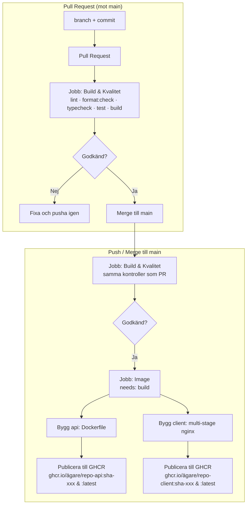

flowchart LR
  B[branch + commit] --> PR[pull request]
  PR --> Q[Kvalitet: lint · format · test]
  PR --> BU[Bygg]
  Q --> S{gröna?}
  BU --> S
  S -->|ja| M[merge]

# CI/CD Pipeline (`main-protection`)

Projektets pipeline är definierad i [`.github/workflows/ci.yml`](../.github/workflows/ci.yml) och körs via GitHub Actions på `ubuntu-latest`.

## Översikt & Arbetsflöde

## Pipelinens Jobb

### 1. `build` (Kvalitets- och byggkontroll)
Körs på både Pull Requests och pushes mot `main`:
1. **Checkout & Node-miljö:** Hämtar repo (`actions/checkout@v4`) och sätter upp Node.js v22 med npm-cache (`actions/setup-node@v4`).
2. **Beroenden:** `npm ci` installerar låsta beroenden för hela workspacet.
3. **Statisk analys:** `npm run lint` (ESLint) och `npm run format:check` (Prettier).
4. **Typkontroll:** `npm run typecheck` (`tsc` för api och `vue-tsc` för client).
5. **Enhetstester:** `npm test` (Vitest för klientens komponenter och API-hjälpare).
6. **Klientbygge:** `npm run build` (Vite-bygge av produktionsfiler).

### 2. `image` (Docker Image & GHCR-publicering)
Körs efter att jobbet `build` har lyckats (`needs: [build]`):
- **Beroenden & Miljö:** Sätter upp Docker Buildx via `docker/setup-buildx-action@v3`.
- **Autentisering:** Loggar in mot GitHub Container Registry (`ghcr.io`) med `GITHUB_TOKEN` vid push till `main`.
- **Metadata & Taggar:** `docker/metadata-action@v5` genererar taggar:
  - `type=sha` (t.ex. `ghcr.io/<org>/utpost-api:sha-6451459`)
  - `type=raw,value=latest` (endast för default-branchen `main`)
- **Bygge och cache:**
  - `api/Dockerfile` byggs med repots rot som kontext.
  - `client/Dockerfile` byggs multi-stage (Node-byggsteg följt av `nginx:1.27-alpine` under 100 MB).
  - Båda stegen använder GitHub Actions cache (`type=gha`) för snabbare efterföljande byggen.
  - Image publiceras (`push: true`) till GitHub Packages när eventet är en push till `main`.
  S -->|nej| F[fixa, pusha igen]