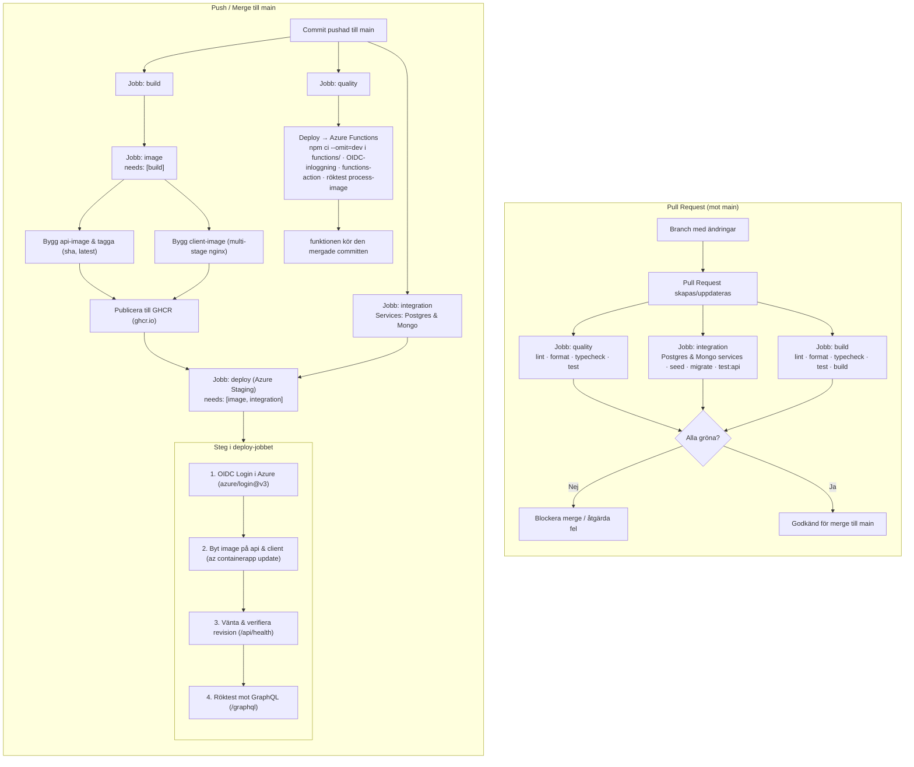

# CI/CD Pipeline (`main-protection`)

Projektets pipeline är definierad i [`.github/workflows/ci.yml`](../.github/workflows/ci.yml) och körs via GitHub Actions på `ubuntu-latest`. Pipelinen validerar kodkvalitet, integrationstester och byggen vid Pull Requests samt sköter image-publicering och automatisk driftsättning (CD) till Azure Container Apps vid merge/push till `main`.

## Översikt & Arbetsflöde



---

## Pipelinens Jobb

### 1. `quality` (Kvalitetskontroller)
Körs på både Pull Requests och pushes mot `main`:
1. **Node.js-miljö:** Sätter upp Node.js v22 med npm-cache (`actions/setup-node@v4`).
2. **Beroenden:** `npm ci` installerar låsta beroenden för alla workspaces (`api`, `client`, `shared`).
3. **Statisk analys:** `npm run lint` (ESLint) och `npm run format:check` (Prettier).
4. **Typkontroll:** `npm run typecheck` (`tsc` för API och `vue-tsc` för klienten kontrollerar att kontraktet i `@utpost/shared` efterlevs).
5. **Enhetstester:** `npm test` kör enhetstester för frontend och hjälparfunktioner.

### 2. `integration` (Integrationstester mot databaser)
Körs på både Pull Requests och pushes mot `main`:
1. **Container Services:** GitHub Actions startar två container-services direkt i CI-jobbet med hälsokontroller (`options: --health-cmd`):
   - `postgres:16` på port `5432:5432`
   - `mongo:8.2` på port `27017:27017`
2. **Miljövariabler:** Sätter `DATABASE_URL` och `MONGO_URL` mot `localhost`.
3. **Seed & Migrering:**
   - `npm run seed`: Skapar tabeller och sätter in startdata i PostgreSQL.
   - `npm run migrate:logs`: Migrerar mätpunkter och GPS-loggar till MongoDB.
4. **Integrationstester:** `npm run test:api` exekverar API- och GraphQL-testerna mot de körande databaserna.

### 3. `build` (Byggkontroll)
Körs på både Pull Requests och pushes mot `main`:
1. Utför verifierande tester och kontroller.
2. Bygger klientapplikationens produktionsfiler via `npm run build`.

### 4. `image` (Docker Image & GHCR-publicering)
Körs enbart vid pushes/merges till `main`, och kräver att `build` har lyckats (`needs: [build]`):
- **Docker Buildx:** Initieras via `docker/setup-buildx-action@v3`.
- **Autentisering:** Loggar in mot GitHub Packages Container Registry (`ghcr.io`) via `docker/login-action@v3` med `secrets.GITHUB_TOKEN` (`packages: write`).
- **Metadata & Taggar:** `docker/metadata-action@v5` genererar taggar:
  - `type=sha` (t.ex. `ghcr.io/<ägare>/<repo>-api:sha-1a2b3c4`)
  - `type=raw,value=latest` (för default-branch `main`)
- **Bygge och cache:**
  - `api/Dockerfile` byggs med repots rot som kontext (kopierar delade `@utpost/shared`).
  - `client/Dockerfile` byggs multi-stage (Node.js för Vite-bygge, `nginx:1.27-alpine` för distribution, slutstorlek ~74 MB).
  - Båda stegen använder GitHub Actions cache (`type=gha`) för snabba inkrementella byggen.
  - Avbildningarna pushas (`push: true`) till GHCR vid push till `main`.

### 5. `deploy` (Deploy till Azure Staging)
Körs automatiskt vid push till `main`, under förutsättning att **både** `image` och `integration` har lyckats (`needs: [image, integration]`):

#### Villkor & Miljö
- **Triggers:** `if: github.event_name == 'push' && github.ref == 'refs/heads/main'`.
- **Miljö:** `environment: azure-staging` med `url: ${{ vars.AZURE_URL }}` (tillhandahåller miljöspecifika variabler och synliggör driftsättningslänk i GitHub).
- **Concurrency:** `group: deploy-staging` med `cancel-in-progress: false` gör att eventuella överlappande deployer köas i ordning utan att avbryta en pågående revisionsuppdatering.

#### Säkerhet & Autentisering (OIDC)
- **Lösenordsfritt:** `permissions: id-token: write` tillåter jobbet att begära en kortlivad OIDC-token från GitHub.
- **Inloggning:** `azure/login@v3` loggar in mot Azure AD med federerad identitet:
  - `client-id: ${{ vars.AZURE_CLIENT_ID }}`
  - `tenant-id: ${{ vars.AZURE_TENANT_ID }}`
  - `subscription-id: ${{ vars.AZURE_SUBSCRIPTION_ID }}`
- Inga statiska hemligheter eller Azure Client Secrets behöver sparas i repot.

#### Steg i driftsättningen
1. **Uppdatera container-avbildningar i Azure Container Apps:**
   - Installerar/uppdaterar `containerapp`-tillägget i `az CLI`.
   - Uppdaterar containern `api` till `ghcr.io/<repo>-api:sha-<commit>` med revision-suffix `sha-<commit>-api`.
   - Uppdaterar containern `client` till `ghcr.io/<repo>-client:sha-<commit>` med revision-suffix `sha-<commit>`.
2. **Vänta och verifiera aktiv revision:**
   - Pollar `$AZURE_URL/api/health` och kontrollerar via `az containerapp show` att den senaste aktiva revisionen motsvarar den driftsatta committen.
   - Körs i loop med upp till 30 försök (10 sekunders intervall, max 5 minuter).
3. **Röktest via GraphQL:**
   - Skickar en GraphQL-förfrågan mot `$AZURE_URL/graphql`:
     ```graphql
     { tours(limit: 1) { id user { displayName } } }
     ```
   - Validerar att svaret returnerar data (`displayName`) genom Nginx-proxyn från den seedade databasen, vilket verifierar att hela anropskedjan (Nginx → API → Postgres) är intakt.

---

## `npm ci` före och efter att `web/` togs bort (M6)

React-klienten (`web/`) togs bort när alla vyer var portade till Vue (`client/`). Mätt lokalt i en ren kopia av `main`, tre körningar var, med varm npm-cache (som `cache: npm` i pipelinen), tid enligt npm:

| | Workspaces | Paket | `npm ci` | `node_modules` |
|---|---|---|---|---|
| Före | api, web, client, shared | 904 | 55 / 57 / 56 s | 321 MB |
| Efter | api, client, shared | 888 | 56 / 55 / 56 s | 312 MB |

Tiden ändras inte mätbart. React-klienten hade bara tre egna beroenden (`react`, `react-dom`, `react-router-dom`) – Vite, ESLint och resten av verktygen delades redan med `client/`. Vinsten är inte sekunder utan en klient i stället för två: en uppsättning vyer, tester och byggsteg. I pipelinen tog steget `npm ci` 5–23 s per jobb före borttagningen, beroende på hur varm cachen var.

---

## Pipelinens Jobbtabell

| Jobb | Vad det gör | Vad det skyddar mot | Tidsåtgång |
|---|---|---|---|
| **Kvalitet (`quality`)** | Lint, format, typecheck, enhetstester | Syntaxfel, formateringsfel, TypeScript-kontraktsbrott | ~1 min |
| **Integration (`integration`)** | Kör integrationstester mot riktiga Postgres- och Mongo-databaser | Trasiga API-endpoints, SQL/Mongo-fel, DataLoader-regressioner | ~1 min |
| **Bygg (`build`)** | Bygger Vue-klienten för produktion | Trasiga frontend-byggen | ~1 min |
| **Image (`image`)** | Docker buildx & push till GHCR | Image-byggfel, saknade filer i container | ~1,5 min |
| **Deploy (M6)** | `az containerapp update … --image …:sha-…` ×2 (api, client – två revisioner per deploy), vänta på `sha` i `/api/health` och på sista revisionen, röktest `/graphql` | En image som inte startar, en nginx-mall som inte renderas, en app som inte kommer upp – innan någon användare ser det | ~1,5 min (bara på `main`; väcks appen från noll tillkommer ~1 min) |
| **Deploy → Azure Functions (M7)** | `npm ci --omit=dev` i `functions/`, `Azure/functions-action@v1`, röktest: `POST /api/process-image` med nyckeln hämtad i jobbet | En funktion som inte startar i Azure, ett paket utan `node_modules`, fel app-namn | ~51s (från Actions-körning 42803785358) (bara på `main`; röktestet är en kallstart) |

---

## Branch Protection & Deploy-strategi

- *Deploy → Azure staging* är **inte** en status check: den körs efter merge, på `main`. Blir den röd är `main` ändå korrekt – det är staging som inte uppdaterades. Rätta och merga igen, eller rulla tillbaka med `az containerapp update … --image <förra sha-taggen>` (varje image i GHCR har sin sha-tagg kvar).
- *Deploy → Azure Functions* (M7) är inte heller en status check. **Två deployjobb, oberoende av varandra** – API:et läser funktionens adress ur miljön, så ordningen spelar ingen roll.

---

## Kända fel & Felsökning

- **Deploy rött med *AADSTS700213 No matching federated identity record*:** Subjectet stämmer inte. Felmeddelandet skriver ut det subject GitHub skickade – skapa en federerad identitet till med exakt det värdet (`az ad app federated-credential create`, nytt `name`). Jobbet måste också ha `environment: azure-staging`.
- **Deploy rött på *Vänta tills staging kör den här committen*:** Appen startar från noll (fyra containrar + seed, ~1 min) – 30 försök à 10 s brukar räcka. Står `sha` kvar på det gamla värdet efter fem minuter: revisionen startade inte. `az containerapp logs show --name utpost-staging --resource-group utpost-benjamin-klingberg-rg --container api --tail 50`.
- **Deploy rött på röktestet men väntan grön:** `/api/health` svarar genom nginx (så `API_UPSTREAM` är rätt), men GraphQL ger ingen data – databasen är tom (`SEED_ON_START` saknas eller seeden misslyckades: `az containerapp logs show … --container api`). Är det väntan som är röd med `502`/inget svar är det nginx som inte når api: `API_UPSTREAM` ska vara `localhost:4000` i Azure.
- **Deploy rött på *revision already exists*:** Jobbet kördes om (Re-run) och revisionssuffixet `sha-<7>` är redan använt. Suffixet är commitens sha, så vägen framåt är en ny commit – inte Re-run.

---

## Azure Staging-infrastruktur

Infrastrukturen för staging är deklarerad i repot och förbereds manuellt en gång per team:
- [`infra/azure/skapa-staging.sh`](../infra/azure/skapa-staging.sh): Skapar Azure-resursgrupp (`utpost-benjamin-klingberg-rg`), Container App-miljö (`utpost-env`) och Container Appen ur `staging.yaml`.
- [`infra/azure/identitet.sh`](../infra/azure/identitet.sh): Skapar en Azure App Registration och Service Principal med rollen `Contributor` på resursgruppen, sätter upp federerad OIDC-koppling mot GitHub-miljön `azure-staging`, samt sätter motsvarande variabler i GitHub via GitHub CLI (`gh`).
- [`infra/azure/staging.yaml`](../infra/azure/staging.yaml): Container App-specifikation som kör hela stacken (`client`, `api`, `postgres`, `mongo`) i samma app på delad `localhost`.